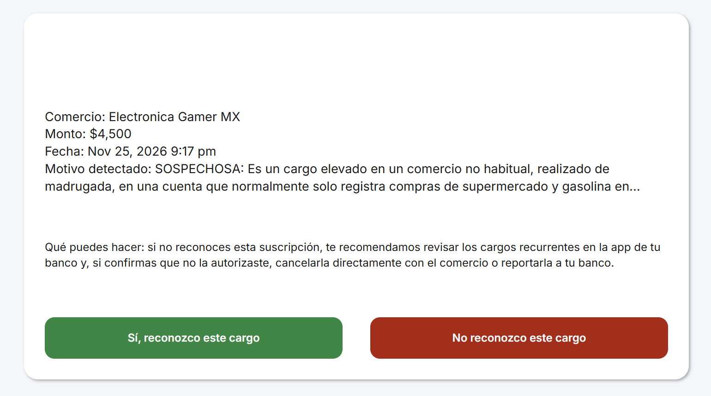

# Vigilio — página de memoria del proyecto

  

**Versión de esta página: 25-nov-2026.** Esta página es guía semanal, plan de negocio y memoria de calificación a la vez — cada sección muestra una decisión del equipo y su evidencia, no una respuesta de IA copiada. Donde falta evidencia real, se marca **PENDIENTE**, no se rellena para que se vea completo. El detalle extendido de cada semana vive en [Semanas](semanas/) — aquí va la versión de una pantalla por sección.

**Equipo:** Axel Vergara Páez — trabajo individual, confirmado con el profesor (ver sección 1).

---

## Índice rápido

Pica el tema que quieras ver — te lleva directo a esa sección, sin tener que bajar por toda la página.

- [0. Resumen ejecutivo](#sec-0)
- [Parte I — Oportunidad y mercado](#parte-i)
  - [1. Equipo](#sec-1) · [2. Problema y oportunidad](#sec-2) · [3. Usuario y evidencia de campo](#sec-3) · [4. Mercado y competencia](#sec-4) · [5. Propuesta de valor y oferta](#sec-5) · [6. Propiedad intelectual, marca y vigilancia](#sec-6)
- [Parte II — Producto](#parte-ii)
  - [7. Especificación del producto (PDS)](#sec-7) · [8. Arquitectura del sistema](#sec-8) · [9. Diseño del producto — Pugh](#sec-9) · [10. Prototipos y evidencia](#sec-10) · [11. Manufactura, DFM y circularidad](#sec-11) · [12. Aplicación conectada](#sec-12)
- [Parte III — Negocio](#parte-iii)
  - [13. Modelo de negocio (Business Blueprint)](#sec-13) · [14. Costos, precio y viabilidad financiera](#sec-14) · [15. Go-to-market y economía unitaria](#sec-15) · [16. Regulación y aspectos legales](#sec-16)
- [Parte IV — Validación y lanzamiento](#parte-iv)
  - [17. Integración y pruebas del sistema](#sec-17) · [18. Pruebas con usuarios](#sec-18) · [19. Landing page](#sec-19) · [20. Pitch y demo](#sec-20)
- [Parte V — Cierre](#parte-v)
  - [21. Uso de IA en el proyecto](#sec-21) · [22. Reflexión y siguientes pasos](#sec-22)
- [Anexos](#anexos)

---

## 0. Resumen ejecutivo {#sec-0}

*Versión: 25-nov-2026 · Semana 9.*

**Vigilio**  — *"Vigilio vigila lo que tu banco no ve."*

**Propuesta de valor (≤25 palabras):** "A diferencia de la banca tradicional, que tarda meses en innovar, Vigilio ya avisa hoy de los cargos chicos que ellos tardan en detectar."

**Foto/evidencia:**

  

Captura real de la pantalla de alerta generada por el clasificador de IA en producción (no un mockup) — comercio Electrónica Gamer MX, $4,500 MXN, 25-nov-2026, 9:17 pm.

**3 cifras clave:**
1. SOM año 1-2: 300 a 600 hogares (~$361K-723K MXN)
2. LTV ÷ inversión = 3.25 (payback 5.46 meses)
3. 9 entrevistas de validación reales (3 de 9 dispuestos a pagar directamente)

**Estado honesto, en una oración:** MVP funcional con ambos lados (hijo y padre/madre) construido y probado; 0 de 5 pruebas de usuario se completaron sin ayuda y 0 preórdenes pagadas, con los 3 ajustes prioritarios ya identificados.

**Enlaces:** [repositorio y bitácora](https://github.com/vergarapaezaxelmanuel-cyber/axel-vergara-engineering-project-4) · <a href="https://vergarapaezaxelmanuel.bubbleapps.io/version-test" style="font-weight:700; background:#fde68a; color:#1a1a2e; padding:3px 10px; border-radius:6px; text-decoration:none; display:inline-block;">👉 app en vivo — pícale aquí</a> · <a href="https://youtu.be/K74nFRy1xBY" style="font-weight:700; background:#fde68a; color:#1a1a2e; padding:3px 10px; border-radius:6px; text-decoration:none; display:inline-block;">🎥 video de demo (Plan B) — pícale aquí</a> · <a href="https://vergarapaezaxelmanuel-cyber.github.io/axel-vergara-engineering-project-4/prototipo-vigilio.html" style="font-weight:700; background:#fde68a; color:#1a1a2e; padding:3px 10px; border-radius:6px; text-decoration:none; display:inline-block;">🔗 landing (reserva tu lugar) — pícale aquí</a> · pitch y demo (sección 20).

---

## Parte I — Oportunidad y mercado {#parte-i}

### 1. Equipo {#sec-1}

*Versión: 25-nov-2026 · Semana 1.*

**Decisión:** Vigilio se desarrolla como proyecto individual — Axel Vergara Páez, Ingeniería en Negocios, 7º semestre, Ibero Puebla. Confirmado como válido con el profesor.

**Evidencia:** sin compañeros de equipo en ninguna entrega del semestre.

**Por qué este proyecto (razón personal):** mi mamá ha sufrido cargos y suscripciones que no reconoce en su cuenta — el problema no se inventó para la clase.

---

### 2. Problema y oportunidad {#sec-2}

*Versión: 23-nov-2026 · Semana 2.*

**Decisión:** los hijos adultos que cuidan las finanzas de un padre/madre mayor se enteran tarde de cargos pequeños no autorizados (card testing, suscripciones mal activadas o que se siguen cobrando), porque ni el banco avisa por montos chicos ni el padre/madre revisa su cuenta lo bastante seguido.

**Evidencia:**
- Card testing: cargos de **$0.50–$5 USD**, deliberadamente bajo el umbral de alerta bancaria (Mastercard Newsroom, 2024).
- En México, **1 de cada 3** víctimas de fraude bancario ya es adulto mayor; quejas por fraude digital **+11.4% en 2026** (Condusef, vía El Imparcial, 2026).
- Caso real: María acumuló **$8,500 MXN** en cargos "hormiga" de Uber Eats (de $150 y $300 MXN cada uno) desde marzo, sin usar esa app hace un año y sin detectarlo durante meses (`canvas-mercado-semana4.md`; sección 3).

**Qué falta:** nada — cerrado desde Semana 2.

[Ver el proceso completo de Semana 2 →](semanas/evidencia-semana-02.html)

---

### 3. Usuario y evidencia de campo {#sec-3}

*Versión: 23-nov-2026 · Semanas 3-4.*

**Decisión:** el comprador es el hijo/a (24 años en adelante, con ingreso propio) que ya cuida o podría cuidar las finanzas de un padre/madre de 60-70 años; el padre/madre da el consentimiento pero no paga.

**Evidencia — 9 entrevistas (3 núcleos familiares + 2 contactos externos):**

| Capa del segmento | Hallazgo | Estado |
|---|---|---|
| Demográfica | Hijo/a 24+ con ingreso propio; padre/madre 60-70, zona urbana (Puebla) | ✅ VERIFICADO (9 entrevistas) |
| Conductual | Quien detecta el cargo primero es el padre/madre o el banco en 5 de 7 casos núcleo, no el hijo/a | ✅ VERIFICADO |
| Psicográfica | El padre/madre rechaza sentirse "fiscalizado"; prefiere solo alertas de anomalías | ✅ VERIFICADO (1 entrevista, María) |
| Económica | 4 de 7 núcleo no rechazan pagar, con anclaje espontáneo cerca de $99 MXN/mes | ✅ VERIFICADO, parcial — n pequeña |

**Hallazgo honesto:** la Hipótesis 3 (frecuencia del patrón ≥ cada 2-3 meses) no se sostiene con la muestra actual — solo 1 de 7 la cumple.

**Qué falta:** ronda adicional fuera del círculo cercano de Axel, y más entrevistas del lado padre/madre (hoy solo María).

[Ver Semana 3 →](semanas/evidencia-semana-03.html) · [Ver Semana 4 →](semanas/evidencia-semana-04.html)

---

### 4. Mercado y competencia {#sec-4}

*Versión: 23-nov-2026 · Semana 4.*

**Decisión:** Vigilio compite en un espacio libre en México — detección de cargos chicos en tiempo real, dirigida al hijo/a, sin quitarle al padre/madre el control de su cuenta.

**Tamaño de mercado (de abajo hacia arriba):**

| | Cálculo | Valor |
|---|---|---|
| TAM | 17.1M adultos 60+ en México (Conapo, 2025) con hijo adulto (supuesto 85%) | ≈14.5M personas (~$17,226M MXN/año) |
| SAM | Filtrado por urbanización, bancarización (ENIF 2024) y NSE AB/C+ | ≈2.05M personas (~$2,435M MXN/año) |
| SOM año 1-2 | Zona Puebla-Tlaxcala, penetración de lanzamiento 0.5-1% | 304-608 hogares (~$361k-$723k MXN) |

**Competencia:** 3 directos internacionales que no operan en pesos/México (EverSafe, Carefull, True Link Financial); el riesgo estructural real es que un banco mexicano lo construya internamente — ventana de ~12 meses de ventaja (SoFi Tech Solutions, 2026).

**Qué falta:** verificar con fuente primaria (AMAI, ENIF desagregada) los supuestos más frágiles del tamaño de mercado.

[Ver Semana 4 →](semanas/evidencia-semana-04.html)

---

### 5. Propuesta de valor y oferta {#sec-5}

*Versión: 25-nov-2026 · Semana 4.*

**Decisión:** la propuesta se dirige a un único comprador (el hijo/a), nombra un competidor específico (la banca tradicional) y no sobrepromete. Acceso de solo lectura bajo Belvo/CNBV — copiarlo exige repetir el trabajo de entrevistas reales, no solo la tecnología.

**Slogan:** *"Vigilio vigila lo que tu banco no ve."*

**Propuesta de valor:** "A diferencia de la banca tradicional en México, que tarda hasta 12 meses en lanzar una función nueva, Vigilio ya te avisa hoy de los cargos chicos que sus alertas no marcan por estar calibradas para montos grandes — sin quitarle a tu papá o mamá el control de su cuenta."

**Evidencia:** ningún entrevistado mencionó conocer una herramienta similar operando en México; los 3 competidores directos (sección 4) no operan en pesos ni en bancos mexicanos.

**Qué falta:** leer la propuesta en voz alta a alguien fuera del proyecto y confirmar que la entiende (abierto desde Semana 4).

[Ver Semana 4 →](semanas/evidencia-semana-04.html)

---

### 6. Propiedad intelectual, marca y vigilancia {#sec-6}

*Versión: 25-nov-2026 · Semana 3.*

**Decisión:** Vigilio pasó una búsqueda fonética real en el Acervo de Marcas del IMPI (acervomarcas.impi.gob.mx) antes de cerrarse como nombre.

**Evidencia:** de 3 finalistas evaluados con IA sobre 5 criterios de branding (Vigilio, Alento, Kuido), Kuido se descartó al encontrar una marca idéntica ya registrada (Clase 16) en un giro conceptualmente cercano; **Vigilio salió sin ningún resultado**, tanto en búsqueda amplia como exacta (captura real: "No se encontró información asociada a la denominación VIGILIO", verificado 25-nov-2026); Alento solo salió limpio con el filtro de coincidencia exacta. Vigilio se eligió sobre Alento por no tener conflicto de dominio en México (Alento sí lo tiene, por confusión con "Talento") — el uso de "Vigilio" por dos empresas fuera de México no se considera riesgo, porque el producto solo se vende en México. No se requiere análisis de libertad de operación (FTO): el producto combina servicios ya licenciados (Belvo, Anthropic), no un mecanismo propio patentable en conflicto.

**Qué falta:** nada — cerrado.

---

## Parte II — Producto {#parte-ii}

### 7. Especificación del producto (PDS) {#sec-7}

*Versión: 23-nov-2026 · Semana 5.*

**Decisión:** el PDS tiene **22 requerimientos** (mínimo pedido: 16, 4 por categoría) en 4 categorías, cada uno con criterio de aceptación verificable.

| Categoría | Requerimientos | Ejemplos |
|---|---|---|
| Funcionales (6) | RF-01 a RF-06 | Detección y clasificación de cargos; alerta al hijo/a; guía de resolución; portal de consentimiento |
| Desempeño (4) | RD-01 a RD-04 | Tiempo máximo de alerta; tasa de falsos positivos; disponibilidad; capacidad del piloto |
| Interfaz (5) | RI-01 a RI-05 | Integración solo lectura con Belvo; canal de notificación; 4 pantallas mínimas; accesibilidad |
| Restricción (7) | RR-01 a RR-07 | Consentimiento revocable; software-only; sin control de gasto; ciclo de vida de datos |

**Columna de estado (Semana 9):** de los 22, ✅ 8 Cumple (RF-02, RF-05, RI-02, RI-03, RR-01, RR-02, RR-03, RR-06), ⚠️ 6 Parcial (RF-01, RF-03, RF-04, RD-03, RI-01, RR-04) y ❌ 8 No cumple/pendiente de probar (RF-06, RD-01, RD-02, RD-04, RI-04, RI-05, RR-05, RR-07) — **tabla completa, requerimiento por requerimiento, en la [evidencia de Semana 9](semanas/evidencia-semana-09.html#estado-de-los-22-requerimientos).**

**Qué falta:** cerrar la columna de estado con Semana 9.

[Ver Semana 5 →](semanas/evidencia-semana-05.html)

---

### 8. Arquitectura del sistema {#sec-8}

*Versión: 23-nov-2026 · Semana 5.*

**Decisión:** arquitectura **100% Cloud** — sin capa física ni edge, porque el dato ya nace en el banco y el requerimiento de desempeño (≤15 min de alerta) no exige latencia de milisegundos.

**Flujo:** Banco → Belvo (webhook, solo lectura) → Backend/Bubble → Clasificador (Claude Haiku, few-shot) → Notificación al hijo/a.

**Evidencia:** latencia estimada ≈3-6 segundos, muy por debajo del margen de 15 min. Belvo Production no es viable al precio validado (~$1,000 USD/mes fijo vs. $99 MXN/mes a escala de piloto) — por eso el proyecto se queda en Sandbox.

**Qué falta:** verificar qué bancos mexicanos están disponibles en Belvo; decidir si el piloto necesita app publicada ($685.62 MXN/mes, Bubble Starter) o basta demo en editor.

[Ver Semana 5 →](semanas/evidencia-semana-05.html)

---

### 9. Diseño del producto — Pugh {#sec-9}

*Versión: 23-nov-2026 · Semana 6.*

**Decisión:** concepto ganador — **"Vigilio a Distancia"**: onboarding asistido por videollamada, resumen diario por correo, llamada automatizada semanal al padre/madre, vista jerárquica por banco.

**Evidencia — Matriz de Pugh** (datum: Vigilio Colaborativo), 9 criterios: C1 Inmediato = −42 · C2 Colaborativo (datum) = 0 · **C3 A Distancia = +3 (ganador)**. Ganó por alineación con el propósito; perdió frente a C1 en velocidad de alerta.

**Iteración adoptada (sección 8):** escalamiento híbrido — correo diario por default, push/SMS inmediato si hay alta confianza de fraude.

**Nota de adaptación:** el material pide "los 7 principios de diseño industrial aplicados al objeto" — Vigilio no tiene objeto físico; se aplicaron principios de diseño de interacción (jerarquía visual, fricción de consentimiento), declarado así en vez de forzar un mapeo falso.

[Ver Semana 6 →](semanas/evidencia-semana-06.html)

---

### 10. Prototipos y evidencia {#sec-10}

*Versión: 25-nov-2026 · Semana 8.*

**Decisión:** Semana 8 ejecuta el Prototipo de Negocio sobre el supuesto de mayor riesgo sin validar — que los hijos/as que dijeron "sí pagaría" en entrevista completarían una pre-orden real a $99 MXN/mes.

**Qué se construyó:** extensión de la landing con precio real, video del clasificador en acción, y pre-orden real vía WhatsApp (no Stripe automatizado — requiere RFC, no viable en el tiempo disponible).

**Hallazgo DFM:** el salto de costo fijo más grande no es la IA, es Belvo Sandbox → Production (~$17,580 MXN/mes) — equivalente a un molde de inyección en manufactura física. El onboarding asistido por videollamada no escala 1:1; se adoptó autoservicio por default vía el widget de Belvo, dejando la videollamada como soporte opcional.

**Qué falta:** evidencia real de cuántos contactos completaron la pre-orden por WhatsApp (umbral propuesto: 3 de 7-9) — no se fabrica sin esa evidencia.

[Ver Semana 8 →](semanas/evidencia-semana-08.html)

---

### 11. Manufactura, DFM y circularidad {#sec-11}

*Versión: 25-nov-2026 · Semanas 5, 7 y 8.*

**Decisión:** Vigilio es software-only (RR-02). El "BOM" es costo de servicios: Belvo $0 en Sandbox (desarrollo) pero **$17,580 MXN/mes en producción** (plan Launch, necesario para conectar cuentas bancarias reales — ver sección 14), clasificador Claude Haiku 5.5 (centavos de dólar/clasificación), Bubble Starter $685.62 MXN/mes si se publica, más Claude Pro $351.60 MXN/mes (asistente de desarrollo de Axel, no el motor de la app).

**Evidencia:** detalle completo en `bom-costo-ia-semana7-vigilio.md`, verificado contra `bubble.io/pricing` y `claude.com/pricing` (25-nov-2026).

**Qué cambió:** Bubble bajó de $1,037 a $685.62 MXN/mes; se agregó Claude Pro — efecto neto de $0.22 MXN, inmaterial (sección 14).

[Ver Semana 7 →](semanas/evidencia-semana-07.html) · [Ver Semana 8 →](semanas/evidencia-semana-08.html)

---

### 12. Aplicación conectada {#sec-12}

*Versión: 25-nov-2026 · Semanas 6 y 9.*

**Decisión:** la app está construida en Bubble — 11 páginas (índice, inicio, alertas, conectar_cuenta, detalle_transaccion, guia_resolucion, portal_consentimiento, suscripcion, pago_confirmado, restablecer_pw, 404).

**Cómo verla en vivo:** [vergarapaezaxelmanuel.bubbleapps.io/version-test](https://vergarapaezaxelmanuel.bubbleapps.io/version-test)

**Flujo verificado en Preview — lado hijo/a:** `alertas` (tarjeta con color por estado) → `detalle_transaccion` (datos reales) → "Sí, reconozco"/"No reconozco" → `guia_resolucion` → vuelta a `alertas`.

**Flujo verificado — lado padre/madre:** `conectar_cuenta` → `portal_consentimiento` (texto 100% dinámico: hijo/a, banco, fecha).

**Motor de IA:** Claude Haiku 5.5 se dispara al entrar a `alertas` y genera una alerta razonada — evidencia real: *"Electrónica Gamer MX, $4,500, Nov 23 2026 — cargo elevado en comercio atípico"* (sección 18).

**Limitación documentada:** Belvo Sandbox falló en las instituciones con recurso de transacciones (errores 400/500, comportamiento conocido de Belvo); se usan datos simulados con el esquema real de Belvo — equivalente a un *test double* de ingeniería de software (Fowler, 2007), no un dato inventado sin criterio.

**Qué falta:** insertar 3-4 capturas reales de las pantallas.

---

## Parte III — Negocio {#parte-iii}

### 13. Modelo de negocio (Business Blueprint) {#sec-13}

*Versión: 24-nov-2026 · Semanas 4 y 7.*

**Decisión:** Vigilio opera bajo un modelo freemium B2C — gratis hasta detectar el primer problema, luego $99 MXN/mes, pagado por el hijo/a.

**Business Blueprint — las 8 cajas:**

| Caja | Contenido | Respaldo |
|---|---|---|
| Clientes | Hijo/a 24+ con ingreso propio, cuidando a un padre/madre de 60-70, zona urbana (Puebla) | Sección 3 |
| Oferta | App que clasifica movimientos con IA (Claude Haiku) vía Belvo y alerta cargos tipo card-testing o suscripciones no reconocidas | Secciones 7-8 |
| Modelo de ingresos y precio | Freemium — gratis hasta el primer problema, luego $99 MXN/mes | Sección 14 |
| Canales | Venta directa (landing con CTA de WhatsApp); boca a boca en el círculo cercano | Sección 19 |
| Propuesta de valor | "Vigilio vigila lo que tu banco no ve" | Sección 5 |
| Costos | Belvo producción $17,580 MXN/mes (el costo fijo dominante); Claude Haiku, centavos de dólar/clasificación; Bubble $685.62 MXN/mes; Claude Pro $351.60 MXN/mes | Sección 14 |
| Socios | Belvo (IFPE/CNBV); Anthropic (API del modelo de IA) | Secciones 8, 16 |
| Equipo y recursos | Axel Vergara Páez (individual); Bubble; Claude como asistente de desarrollo | Sección 1 |

**Benchmarking:**

| Empresa | Modelo | Por qué no resuelve esto en México hoy |
|---|---|---|
| EverSafe (EE. UU.) | Monitorea cuenta del adulto mayor, avisa a un "trusted advocate" | No opera en pesos ni bancos mexicanos |
| Carefull (EE. UU.) | Se distribuye vía bancos, no directo a la familia | Ciclo de venta a bancos descartado por lento y fuera de control de un fundador individual |
| True Link Financial (EE. UU.) | Tarjeta prepagada para tutores legales | Resuelve tutela formal, no un hijo/a cuidador informal |

**Desafío del modelo:** la conversión de gratis a pago depende de que aparezca una anomalía real — sin un mecanismo de conversión alternativo todavía (ej. resumen periódico de "todo en orden").

---

### 14. Costos, precio y viabilidad financiera {#sec-14}

*Versión: 27-nov-2026 · actualizado con el costo real de Belvo en producción (antes se usaba Belvo Sandbox, $0, que no sirve para cuentas bancarias reales).*

**Decisión:** precio recomendado **$99 MXN/mes** — no es barato "porque sí": con el costo fijo real de operar (dominado por Belvo en producción), el cost-plus a escala pequeña pide mucho más que $99 ($2,953.49/mes a 10 cuentas), y solo baja hasta justificarse por costos (margen 40%) a partir de ~332 cuentas pagando — justo la escala a la que apunta la meta de año 1-2 (304-608 hogares). El precio de $99 se sostiene por el tamaño de mercado al que se apunta, no por ser barato de operar hoy.

**Costo fijo mensual real (reemplaza la cifra anterior que asumía Belvo Sandbox gratis):**

| Componente | Costo/mes |
|---|---|
| Bubble Starter | $685.62 MXN |
| Claude Pro | $351.60 MXN |
| Dominio propio | $18.75 MXN |
| **Belvo producción** (plan Launch, real — no Sandbox) | **$17,580.00 MXN** |
| **Total costo fijo mensual** | **$18,635.97 MXN** |

**Evidencia — unit economics:**

| Métrica | Valor |
|---|---|
| Margen de contribución | $91.62 MXN/cuenta/mes |
| Punto de equilibrio (solo operativo) | **204 cuentas** — ❌ excede el techo del piloto (20-30), ✅ cae dentro de la meta de año 1-2 (304-608) |
| Punto de equilibrio (recuperando inversión en 12 meses) | **230 cuentas** — mismo patrón |
| Flujo mensual positivo desde | no ocurre dentro del año 1 del piloto (máx. 25 cuentas al mes 12); proyectado al mes 17 bajo un supuesto de crecimiento extendido no validado |
| Inversión inicial | $28,638.98 MXN |
| VPN a 12 meses (tasa 15%) | **−$225,958.42 MXN** |

**Hallazgo honesto:** con Belvo en producción, el piloto de 20-30 familias, por diseño, nunca se acerca a su propio punto de equilibrio — un costo fijo de $18,636 MXN/mes no se paga con los ingresos de un piloto de validación. Esto no significa que el modelo esté roto: 204-230 cuentas caen justo dentro de la meta ya declarada de año 1-2 (304-608 hogares), así que el piloto cumple su función (validar, no operar sin pérdida) y el negocio se sostiene solo en la escala a la que ya apuntaba. Lo que sí cambia es la conversación con cualquier inversionista: el proyecto necesita financiamiento externo del orden de ~$225,958 MXN para cruzar del piloto a la escala donde se paga solo, no solo "unos meses más" como sugería el modelo anterior con Belvo Sandbox.

**Qué falta:** confirmar con el profesor si existe un tope real de presupuesto en pesos; validar con Belvo el costo exacto del plan Launch fuera de su página pública de precios.

[Ver Semana 7 →](semanas/evidencia-semana-07.html)

---

### 15. Go-to-market y economía unitaria {#sec-15}

*Versión: 23-nov-2026 · Semana 9.*

**Decisión:** la economía unitaria de adquisición es frágil pero positiva — **LTV/CAC = 3.25**, sobre el piso de referencia de 3.0.

**Evidencia:**

| Métrica | Valor |
|---|---|
| Contribución mensual | $91.613 MXN |
| Vida media del cliente | 17.76 meses (churn 5.63%/mes) |
| LTV | $1,627.23 MXN |
| CAC | $500.00 MXN |
| LTV/CAC | 3.25 |
| Payback | 5.46 meses |

**Hallazgo honesto:** la razón se rompe (cae debajo de 3.0) si el CAC sube más de 5.42 conversaciones por cierre — margen estrecho, no holgura.

**Nota (27-nov-2026):** estos datos NO cambiaron cuando se corrigió el costo fijo de Belvo en sección 14 — miden la rentabilidad de un cliente marginal (precio menos costo variable), mientras que Belvo en producción es un costo fijo que se paga igual con 1 o con 200 clientes. Son dos preguntas distintas: "¿vale la pena cada cliente nuevo?" (sí, 3.25) vs. "¿el negocio completo se paga solo a esta escala?" (no todavía, ver sección 14).

**Qué falta:** validar el CAC real (hoy es supuesto de modelo, no gasto medido con campañas corriendo).

[Ver Semana 9 →](semanas/evidencia-semana-09.html)

---

### 16. Regulación y aspectos legales {#sec-16}

*Versión: 23-nov-2026 · Semanas 8-9.*

**Decisión — checklist de estado regulatorio:**

| Punto | Estado |
|---|---|
| Belvo autorizado por la CNBV como IFPE bajo la Ley Fintech | ✅ VERIFICADO (LatamFintech, 2022) |
| Open Finance Fase 1 (datos abiertos) en vigor | ✅ VERIFICADO desde 2020 |
| Open Finance Fase 3 (datos transaccionales) regulada | ⚠️ PARCIAL — ya sabemos que no hay regulación secundaria publicada todavía (amparo activo desde dic-2025, El Financiero 2026); lo que falta no depende de nosotros, depende de que el regulador la publique |
| Vigilio comunica solo la autorización de Belvo, no una propia | ✅ VERIFICADO (RR-04) |
| Cumplimiento LFPDPPP (consentimiento revocable, ciclo de vida de datos) | ✅ VERIFICADO como requerimiento (RR-01, RR-07) |

**Hallazgo honesto:** no existe hoy en México un marco que autorice específicamente compartir datos transaccionales bancarios con un tercero como Vigilio en producción — el Sandbox del semestre no depende de esto.

[Ver Semana 5 →](semanas/evidencia-semana-05.html)

---

## Parte IV — Validación y lanzamiento {#parte-iv}

### 17. Integración y pruebas del sistema {#sec-17}

*Versión: 25-nov-2026 · Semana 9.*

**Decisión:** Vigilio tiene 4 fronteras (adaptación del marco del curso — Vigilio no tiene artefacto físico):

| Frontera | De → a | Qué puede fallar |
|---|---|---|
| F1 | Banco → Belvo | Fuera del control de Vigilio; falla real documentada del Sandbox |
| F2 | Belvo → Backend (Bubble) | Webhook no llega o llega tarde |
| F3 | Backend → Clasificador de IA | Timeout o error de la API |
| F4 | Backend → App del hijo/a | La alerta no se refleja a tiempo |

**Pruebas T1-T6 — resultados reales, no estimados:**

| Prueba | Aprobado si | Resultado real |
|---|---|---|
| T1 — Conectar cuenta sin ayuda | < 5 min sin intervención | **No se logró.** Se corrió la prueba real con los 5 usuarios; 0/5 completó sin ayuda, mediana 20 min. Confusión "conectar cuenta" vs. "gestionar consentimiento" (sección 18). |
| T2 — Latencia de punta a punta | ≤ 15 min (RD-01) | **No se pudo medir — Belvo falló de su lado** (ver aclaración abajo). Solo hay dato parcial de Haiku (~980.7 ms). |
| T3 — Desconexión y recuperación | Reintenta y avisa retraso (RF-06) | **❌ No cumple — por diseño.** RF-06 está documentado pero nunca se construyó. |
| T4 — Autonomía | N/A | N/A — sin hardware propio. |
| T5 — Falla de la API/Belvo | Degrada con mensaje claro | **❌ No cumple — decisión consciente.** Hoy muestra el error crudo de Belvo (misma causa de fondo que T2, ver aclaración abajo). |
| T6 — Operación continua (48h) | Sin reinicios ni datos perdidos | **⚠ Parcial — evidencia informal.** El link en vivo funcionó sin caídas 23-25-nov (~48h) para usuarios reales. |

**Aclaración (T2 y T5):** la documentación oficial de Belvo para desarrolladores advierte, sobre sus instituciones "externally-managed" del entorno Sandbox, que *"this is an externally-managed sandbox environment, as such we cannot guarantee the quality of the data nor the uptime of the sandbox institution"* (Belvo, s.f., sección "Aggregation Coverage"). Es decir: Belvo mismo documenta, desde antes de que empezáramos a integrar, que estas instituciones mock pueden fallar o no responder, sin garantía de calidad de datos ni de disponibilidad. **La parte honesta que no queremos ocultar:** ese aviso ya existía en su documentación, pero no lo revisamos a tiempo — lo detectamos hasta que la falla ya nos había costado semanas de desarrollo cerca de la entrega, no antes de empezar a integrar. Con el tiempo que quedaba, no nos convino rediseñar el manejo de errores alrededor de esta falla puntual (eso es justo lo que falta en T3/RF-06); se documenta tal cual, con la causa identificada y citada en vez de minimizarla.

**Por qué T1 no se logró y T3/T5 no cumplen, y aun así es evidencia fuerte:** son fallas ya diagnosticadas con evidencia real, no huecos escondidos. T2 quedó sin medir por una causa ajena al equipo (Belvo), no por falta de intento.

**Qué falta:** verificar si el bug de login de David (sección 18) sigue activo; medir T2 cuando Belvo restablezca su servicio.

---

### 18. Pruebas con usuarios {#sec-18}

*Versión: 25-nov-2026 · Semana 9 — 5 sesiones ejecutadas el 23-nov-2026.*

**Decisión:** se ejecutaron las 5 sesiones que exige la rúbrica (María, Pedro, Sofia del segmento + David, Daniela externos), con María cubriendo el perfil padre/madre (RF-04). **0 de 5 (0%) completó la tarea sin ayuda**, mediana 20 min, SEQ promedio 4.8/7.

**Evidencia:** hoja de registro llena + capturas de las 5 sesiones vía Teams (sin video completo — restricción institucional de la Ibero); incluye la alerta real generada por la IA durante la sesión de Sofia (Anexo D).

**Hallazgos por severidad:**

| Severidad | Hallazgo |
|---|---|
| Crítico | David intentó iniciar sesión en vez de registrarse — la pantalla no distingue "ya tengo cuenta" de "soy nuevo". |
| Crítico | María confunde "conectar cuenta" con "gestionar consentimiento" — en el flujo que RF-04 exige sin ayuda. |
| Mayor | Falta claridad sobre revocación del consentimiento (Pedro). |
| Mayor | Orden incorrecto en la guía de resolución (Sofia). |
| Mayor | No es visible que Vigilio no puede cancelar transacciones (Sofia). |
| Menor | 5 hallazgos de forma/CSS/wording. |

**Lectura honesta:** 0% de éxito sin ayuda, pero el SEQ (4.8/7) es más alto de lo que esa tasa sugeriría — pocos puntos de fricción concretos y repetidos, no una app "difícil" en general.

**Los 3 cambios de mayor impacto con menor esfuerzo:**
1. Diferenciar visualmente "conectar cuenta nueva" de "gestionar consentimiento ya dado".
2. Verificar y corregir el bug de login que reportó David.
3. Agregar: "Vigilio no puede cancelar transacciones ni mover dinero."

**Qué falta:** implementar los 3 cambios si el tiempo lo permite; confirmar si el bug de David sigue activo.

[Ver protocolo y síntesis completos →](semanas/evidencia-semana-09.html)

---

### 19. Landing page {#sec-19}

*Versión: 27-nov-2026 · Semana 8 (prototipo) actualizada en Semana 9.*

**Decisión:** landing publicada en GitHub Pages — [prototipo-vigilio.html](prototipo-vigilio.html). Headline y propuesta de valor ya actualizados con el dato validado de "hasta 12 meses" (sección 4) y las cifras reales de validación (9 entrevistas, 3/9 dispuestos a pagar, caso real de $8,500 MXN). El video original (simulado, Semana 8) se archivó como evidencia en [evidencia de Semana 8](semanas/evidencia-semana-08.html) y se reemplazó por un fragmento del demo real de la app funcionando de punta a punta.

**Qué falta:** nada pendiente de este lado — confirmar con el profesor/panel si la cifra de pre-órdenes por WhatsApp cambió desde la pre-reserva (sección 10).

---

### 20. Pitch y demo {#sec-20}

*Versión: 25-nov-2026 · Semana 9 — guiones ya finalizados.*

**Decisión:** guion de pitch de 3 minutos (6 partes, fundador único) y guion de demo de 5 minutos con 12 segundos (ambos lados de la app, plan B verbal para la falla de Belvo), con cifras reales.

**Formato de evaluación:** 15 min por equipo — 3 pitch, 7 demo, 5 retroalimentación. **Viernes 27-nov-2026, 11:00, Salón J143.**

**Pitch (330-360 palabras):**

| Parte | Tiempo | Contenido |
|---|---|---|
| 1. Impacto y problema | 35 s | Caso de $8,500 MXN en cargos hormiga — nunca una definición |
| 2. Solución y por qué nosotros | 35 s | Promesa simple + contraste con revisar la cuenta a mano |
| 3. Mercado y modelo | 35 s | SOM 304-608 hogares, precio $99 MXN/mes, margen $91.62 |
| 4. Tracción | 35 s | 9 entrevistas, 0/5 sin ayuda, LTV/CAC 3.25 frágil, 0 preórdenes |
| 5. Equipo | 15 s | Axel, individual |
| 6. Ask y cierre | 25 s | Piloto con 20 familias en Puebla, 90 días + repetir la promesa |

**Guion completo:** ver [guion de pitch, palabra por palabra →](Claude%20outputs/pitch-guion-semana9-vigilio.html) (1 cifra marcada ⚠️ PENDIENTE de verificar: "3 de 9 pagarían hoy mismo").

**Demo (5 min 12 s):** registro/login hijo → conectar cuenta (Belvo, mención verbal de sandbox) → lista de alertas → detalle de transacción (evento en vivo: clic en "Sí/No reconozco") → guía de resolución → registro/login padre → conectar cuenta + consentimiento → cierre en landing → ask. La limitación de Belvo se menciona solo de palabra, nunca se fuerza un error en pantalla — el demo cierra en el ask, no en una falla.

**Guion completo del demo, con tiempos por pantalla:** [ver guion de navegación →](Claude%20outputs/guion-demo-video-semana9-vigilio.html)

**Banco de preguntas frecuentes del panel, con respuestas y fuentes:** [ver documento completo →](Claude%20outputs/respuestas-preguntas-posibles-proyecto-final-vigilio.html)

**Video de demo (Plan B, 5 min 12 s):** la demo real el viernes se hace en vivo, directamente en la app — este video es el respaldo por si algo falla durante la presentación, no la opción principal.

  <iframe src="https://www.youtube.com/embed/K74nFRy1xBY" title="Vigilio — video de demo (Plan B)" frameborder="0" allowfullscreen style="position:absolute;top:0;left:0;width:100%;height:100%;"></iframe>

**Qué falta:** practicar el timing de ambos guiones antes del viernes.

---

## Parte V — Cierre {#parte-v}

### 21. Uso de IA en el proyecto {#sec-21}

*Versión: 26-nov-2026.*

**Los 5 prompts que más cambiaron el proyecto:**

1. **Semana 2 — verificación de evidencia de deseabilidad.** Se pidió a otra IA (Perplexity) verificar 5 señales de deseabilidad con fuentes reales; devolvió 2 que no se pudieron confirmar de forma independiente (publicaciones de Reddit y una cifra de Facebook). **Caso donde la IA se equivocó:** al revisar esa cifra de Facebook directamente, resultó ser de una nota sobre fraude en apps de préstamos, no sobre fraude a adultos mayores — un dato de otro tema, mal aplicado. Se corrigió reemplazándola por fuentes sí verificadas (Condusef/El Imparcial, 2026), documentado en `reporte-oportunidad-semana2.md`.
2. **Semana 2 — selección de concepto.** Un prompt tipo SCAMPER disruptivo generó y comparó 3 conceptos de negocio distintos (Vigía Corporativo, Guardián Fiduciario, Vigía de Confianza Bancaria) contra el filtro Deseable/Novedoso/Viable. El resultado llevó al pivote real: de un modelo pensado para venderse a bancos, a "Vigilio, modelo hijo-papá" vendido directo a la familia — el concepto que se desarrolló todo el semestre.
3. **Semana 5 — auditoría del PDS.** Se usó el prompt de validación real del profesor (encontrado en el código fuente de su página, no la versión resumida) para auditar un PDS preliminar de 16 requerimientos. La IA encontró 4 huecos reales no considerados (reconexión, manejo de fallo de integración bancaria, accesibilidad para el padre/madre, revocación de datos ya descargados) — se agregaron como RF-05, RF-06, RI-05 y RR-07, llegando a los 22 requerimientos finales.
4. **Semana 3 — búsqueda y selección de marca.** Se evaluaron 3 finalistas (Vigilio, Alento, Kuido) sobre 5 criterios de branding y se cruzaron contra una búsqueda real en el IMPI. La IA identificó que "Kuido" tenía una marca idéntica ya registrada — se descartó antes de invertir más tiempo en ese nombre, dejando a Vigilio como la opción limpia.
5. **Semana 9 — diagnóstico de la falla de Belvo Sandbox.** Ante dos instituciones mock que fallaban (errores 400/500), se investigó si era un bug propio o conocido; se encontró el respaldo oficial en la documentación de Belvo (instituciones "externally-managed", sin garantía de uptime) y se propuso documentar la limitación con datos simulados pero con el esquema real — encuadrado como *test double* de ingeniería de software (Fowler, 2007) — en vez de ocultarla o fabricar una integración que no funcionaba.

**En el producto — qué hace el modelo de IA:** Claude Haiku 5.5 corre vía API (nunca en el teléfono o la computadora del usuario) y compara cada transacción nueva contra el historial normal de esa cuenta — no contra un monto fijo. Recibe los datos de la transacción con el esquema real de Belvo (fecha, monto, comercio, categoría, tipo) y el historial reciente de la cuenta; devuelve una clasificación (sospechosa/normal) y un motivo en lenguaje natural, que es lo que ve el hijo/a en `detalle_transaccion`.

**Costo medido por usuario:** ~$7.39 MXN/cuenta/mes (ver `bom-costo-ia-semana7-vigilio.md`) — menos del 2% del costo unitario total (sección 14).

**Qué pasa si falla:** si la llamada a Haiku falla o tarda demasiado, hoy no se crea una nueva Alerta y el hijo/a simplemente no ve nada nuevo — una falla silenciosa, no un mensaje de error (mismo hueco que T5, sección 17). Es una limitación real, no oculta.

**Por qué el producto sería peor sin IA:** un sistema de reglas fijas necesitaría un umbral de monto por cuenta, y fallaría en los dos sentidos — marcaría como sospechosa una compra grande pero legítima (ej. una compra de temporada), y dejaría pasar justo el patrón que motivó el proyecto: cargos chicos y repetidos de card testing, que nunca cruzan un umbral de monto. Comparar contra el patrón histórico de cada cuenta (comercio, horario, tipo de gasto) es lo que permite detectar eso — es el mecanismo central del producto, no un extra.

**Declaración de transparencia:** toda esta página se construyó con apoyo de Claude (Anthropic) como asistente de investigación, redacción y organización — cada prompt relevante está registrado por semana (ver [Semanas](semanas/)); ninguna prueba de usuario, entrevista o resultado reportado aquí fue generado o simulado por IA en lugar de hacerse de verdad.

---

### 22. Reflexión y siguientes pasos {#sec-22}

*Versión: 26-nov-2026.*

**Aprendizaje del semestre:** construir Vigilio solo, de punta a punta (investigación, PDS, arquitectura, prototipo, modelo financiero, pruebas de usuario y pitch), dejó claro que la parte más difícil no fue la tecnología — fue validar con evidencia real en cada paso en vez de avanzar sobre supuestos cómodos. El hallazgo más incómodo y más útil del semestre: la lógica de negocio puede estar bien pensada (LTV/CAC 3.25, segmento validado con 9 entrevistas) y aun así la app ser difícil de usar en la práctica — 0 de 5 personas completaron la tarea sin ayuda. Son dos tipos de validación distintos, y ninguno sustituye al otro.

**Qué se haría distinto:** (1) probar las instituciones mock de Belvo Sandbox mucho antes, no ya cerca de la entrega — la falla de las dos instituciones con recurso de transacciones consumió tiempo que se pudo haber usado en corregir los hallazgos de las pruebas de usuario. (2) Entrevistar fuera del círculo familiar cercano desde la Semana 3, no después — la muestra real quedó concentrada en 2-3 núcleos familiares, lo que debilita qué tanto se puede generalizar. (3) Construir el manejo de errores (RF-06, T3/T5) en paralelo al resto de la app, no dejarlo para el final, donde ya no hubo tiempo.

**Hipótesis críticas sin verificar:** que el precio de $99 MXN/mes convierte en la práctica, no solo suena bien en una entrevista (sección 3, 14); que el patrón de "involucramiento activo predice disposición a pagar" se sostiene fuera del círculo familiar de Axel; que el CAC de $500 MXN (hoy supuesto de modelo) se parece al CAC real una vez que haya campañas corriendo (sección 15).

**Plan de 90 días (si el piloto avanza):** ejecutar el piloto de 20 familias en Puebla planteado en el pitch (sección 20); implementar primero los 3 cambios de mayor impacto encontrados en las pruebas de usuario (sección 18); medir T2 (latencia real) en cuanto Belvo deje de fallar; usar el flujo de pre-orden por WhatsApp para por fin medir disposición a pagar con comportamiento real, no solo con lo dicho en entrevista.

**Riesgos:** el 30% de la rúbrica para "producto físico con IA" sigue sin una respuesta por escrito del profesor sobre cómo se adapta a un proyecto 100% software — el riesgo de calificación más grande del proyecto, fuera del control de Axel. Depender de un solo fundador (sin equipo) es un riesgo real de continuidad si el proyecto avanza más allá del semestre. Y el costo de pasar Belvo de Sandbox a Producción (~$17,580 MXN/mes) sigue siendo la barrera de escala más grande del modelo (sección 10, 14).

---

## Anexos {#anexos}

- **A) BOM con cotizaciones** — ✅ VERIFICADO, ver [sección 11](#sec-11).
- **B) Repositorio y bitácora** — [enlace al repo de GitHub de este proyecto](https://github.com/vergarapaezaxelmanuel-cyber/axel-vergara-engineering-project-4) (historial de commits y todos los documentos de cada semana).
- **C) Archivos de diseño (CAD/PCB/firmware)** — No aplica (software-only, RR-02). Esta letra es parte del formato fijo de Anexos A-F que pide el profesor para todos los proyectos; se deja explícita como "No aplica" en vez de omitirla, igual que T4 en la sección 17.
- **D) Datos crudos de entrevistas/pruebas** — [ver evidencia completa de Semana 9 →](semanas/evidencia-semana-09.html) (hoja de registro y capturas de las 5 sesiones, incluida la alerta real generada por la IA — sección 18).
- **E) Hoja de cálculo del modelo financiero** — fórmulas en `matematicas-financieras-bloque4-5-semana7-vigilio.md` y `cac-ltv-payback-semana9-vigilio.md`.
- **F) Bibliografía** — ver referencias al final de cada semana en [Semanas](semanas/).
